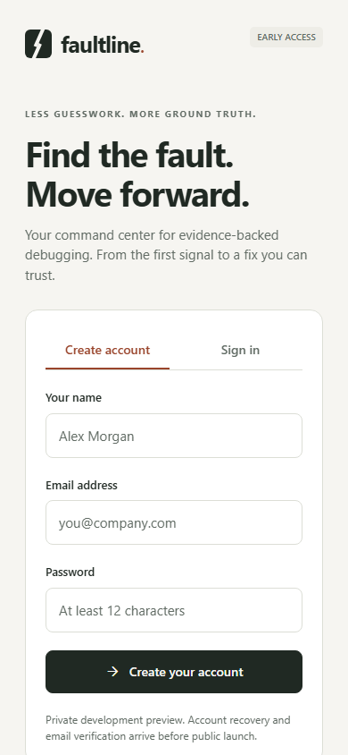
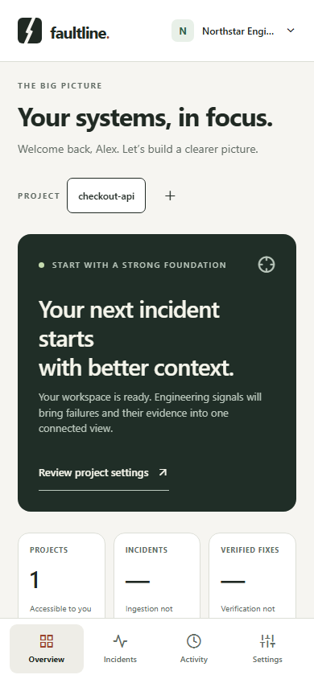
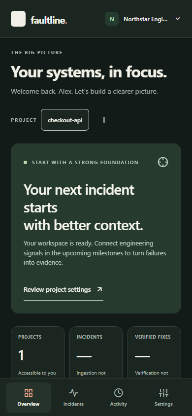
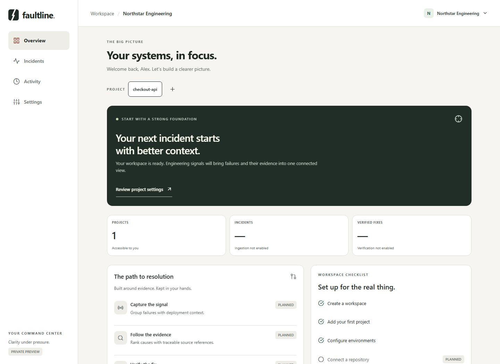

# Faultline

From a production failure to an evidence-backed diagnosis and a verified, human-approved fix.

**Current milestone: M1 — foundation.** The Expo application uses a working FastAPI API for accounts, rotating sessions, workspaces, projects, environments, permissions, and audit activity. Incidents, AI, integrations, patch execution, and draft PRs are planned in M2–M6 and are visibly unavailable in this build.

Read [PRODUCT.md](PRODUCT.md), [ARCHITECTURE.md](ARCHITECTURE.md), and [IMPLEMENTATION_PLAN.md](IMPLEMENTATION_PLAN.md) for scope, boundaries, and the review checkpoints. See [environment configuration](docs/ENVIRONMENT.md) and [security limits](docs/SECURITY.md).

## Prerequisites

- Node 24+, npm, Python 3.12, Git.
- Docker with Compose for the PostgreSQL/Redis stack. SQLite is available for a single-process development preview if Docker is unavailable.
- Expo development build or a compatible Expo Go installation for native device testing. This project uses Expo SDK 58; use a development build if the installed Expo Go does not support it. iOS builds require macOS or a configured remote build service.

## Start with PostgreSQL and Redis

From the repository root:

```powershell
python scripts/setup_dev.py
npm ci
docker compose --env-file .env -f infra/compose.yml up --build
```

Compose starts PostgreSQL and Redis, applies migrations as a one-shot job, then starts the API on port 8000. Database credentials are generated into the ignored root `.env`; the mobile app receives only a public API URL. This configuration is for local development, not production deployment.

In another terminal:

```powershell
npm run mobile
```

For the browser preview:

```powershell
npm run web
```

Open [the web preview](http://localhost:8081) and [the API reference](http://localhost:8000/docs). Adjust `apps/mobile/.env` for an emulator/device as described in [ENVIRONMENT.md](docs/ENVIRONMENT.md). The physical-device API must be reachable over the local network.

## Without Docker: local development fallback

```powershell
python -m venv .venv
.\.venv\Scripts\python.exe -m pip install -r services/api/requirements.lock
python scripts/setup_dev.py
```

If this Windows environment fails during venv's pip bootstrap, use the global pip to target the venv:

```powershell
python -m pip --python .venv install -r services/api/requirements.lock
```

The generated root `.env` defaults to SQLite. If an existing `.env` points to PostgreSQL, either start that database or deliberately select a new SQLite development database. Configuration generation preserves existing values.

```powershell
$env:PYTHONPATH = 'services/api'
.\.venv\Scripts\python.exe -m alembic -c services/api/alembic.ini upgrade head
.\.venv\Scripts\python.exe -m uvicorn faultline.main:create_app --factory --host 127.0.0.1 --port 8000 --no-access-log
```

Then run `npm ci` and `npm run web` in another terminal. Linux/macOS use `.venv/bin/python`, `export PYTHONPATH=services/api`, and the same module commands. The API never creates tables implicitly; readiness fails until migrations run.

For concurrent deployment, replace SQLite with PostgreSQL. Do not treat SQLite's single-process preview as a production authentication store.

## M1 review walkthrough

1. Create an account with a password of at least 12 characters.
2. Create a workspace, then add a project. The API creates its production environment.
3. Open Settings and add a staging environment. Switch between light and dark appearance.
4. Create another account in a separate session. It cannot access the first workspace or project.
5. As the owner, add that existing account by email. Workspace membership alone does not grant project access.
6. Select the member in Settings and grant viewer access to the selected project. Viewer access permits reads and rejects environment creation.
7. Revoke the project grant; subsequent API reads are denied. Activity records the changes.
8. Sign out, restart the API, then sign back in. Workspace/project/environment records persist.

Web credentials intentionally disappear on page reload; native refresh credentials use device secure storage. A real Android/iOS smoke test is still required to validate device-specific storage, keyboard, and navigation behavior.

## Checks

```powershell
.\.venv\Scripts\python.exe -m pytest -q --tb=short
.\.venv\Scripts\ruff.exe check services/api
.\.venv\Scripts\ruff.exe format --check services/api
npm run typecheck
npm run test:mobile
npm run format:check
```

On restricted Windows hosts, pytest may not be able to create its default temporary directory. Set `--basetemp` to a new directory inside `.local/` or run the tests with the required local permissions. Use a new path per run; pytest owns and cleans that directory.

To include PostgreSQL concurrency checks, point `TEST_DATABASE_URL` at a **dedicated disposable** PostgreSQL database before running pytest. The tests repeatedly migrate up/down and delete their tables. The default SQLite run skips the row-lock concurrency test. CI provides a separate PostgreSQL test service.

With API and Expo web servers running:

```powershell
npx playwright install chromium
npm run test:e2e
```

The browser journey uses real API/database writes, creates uniquely named test accounts, checks persistence and offline recovery, and captures screenshots. It does not simulate native secure storage. See [M1 verification](docs/M1_VERIFICATION.md) for measured results and limitations.

Regenerate the API contract after endpoint/schema changes:

```powershell
$env:PYTHONPATH = 'services/api'
.\.venv\Scripts\python.exe services/api/scripts/export_openapi.py
npm run api:generate
```

Do not edit `packages/api-client/schema.d.ts` manually. The mobile client derives request/response types from this generated contract. Commit both OpenAPI JSON and generated declarations. CI checks for schema drift.

## Screenshots

Captured from the running React Native web preview using the real backend. No incident data is fabricated.

| Account creation | Mobile overview | Dark appearance |
| --- | --- | --- |
|  |  |  |



## Operations and next checkpoint

- `/health/live` reports process liveness. `/health/ready` checks database access, migration presence, and Redis when configured.
- `alembic ... upgrade head` applies migrations. Use backups and reviewed forward migrations for real deployments. The initial downgrade deletes foundation tables and is only suitable for disposable development/test databases.
- `docker compose --env-file .env -f infra/compose.yml down` stops local services while preserving volumes. Do not delete volumes containing valuable data.
- CI configuration is included; hosted CI and container builds have not been run in this Docker-less environment.
- M2 adds signed event ingestion, durable jobs, grouping, and a reproducible checkout incident. It starts after M1 review.
